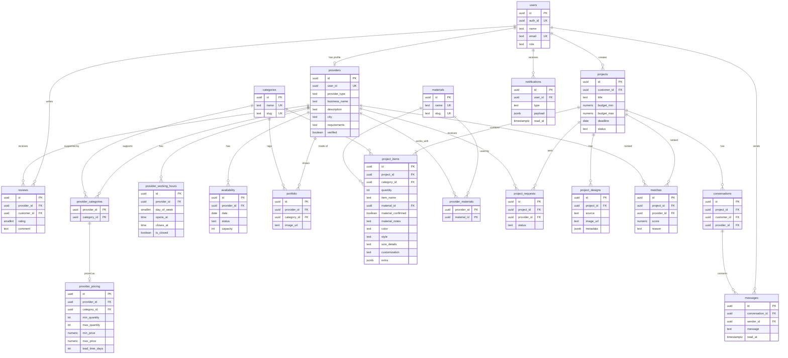

# Database ERD (Sprint 1)

Source of truth: `backend/db/migrations/001` to `004`. The deferred order workflow (`backend/db/deferred/005_order_workflow.sql`) is not drawn here.

View `provider_rating_stats` returns `provider_id`, `rating_avg` and `rating_count` per provider, computed from `reviews` (hidden reviews excluded).

Key constraints:

- `provider_pricing (provider_id, category_id)` references `provider_categories`, so a provider can only price a category it supports.
- `max_quantity >= min_quantity` and `max_price >= min_price`.
- One review per customer per provider.
- A project outside `draft` must have at least one row in `project_items` (trigger).
- `project_items.material_confirmed = true` requires a `material_id`.
- Only one `accepted` request per project (partial unique index).
- `conversations (project_id, customer_id)` is a composite foreign key to `projects`, so the conversation customer always owns the project. A trigger checks that a message sender is the conversation customer or the provider's user.
- Row Level Security is enabled on every table with no policies: only the Express backend (service role) can read or write data.
