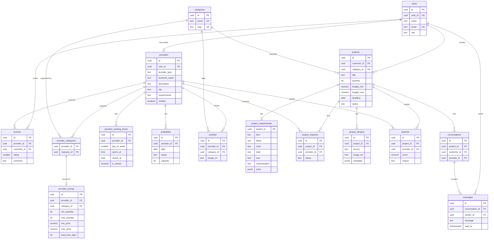

# Database ERD (Sprint 1)

Source of truth: `backend/db/migrations/001_initial_schema.sql`.

View `provider_rating_stats` returns `provider_id`, `rating_avg` and `rating_count` per provider, computed from `reviews` (hidden reviews excluded).

Key constraints:

- `provider_pricing (provider_id, category_id)` references `provider_categories`, so a provider can only price a category it supports.
- `max_quantity >= min_quantity` and `max_price >= min_price`.
- One review per customer per provider.
- A project outside `draft` must have `category_id` and `quantity`.
- Row Level Security is enabled on every table with no policies: only the Express backend (service role) can read or write data.
